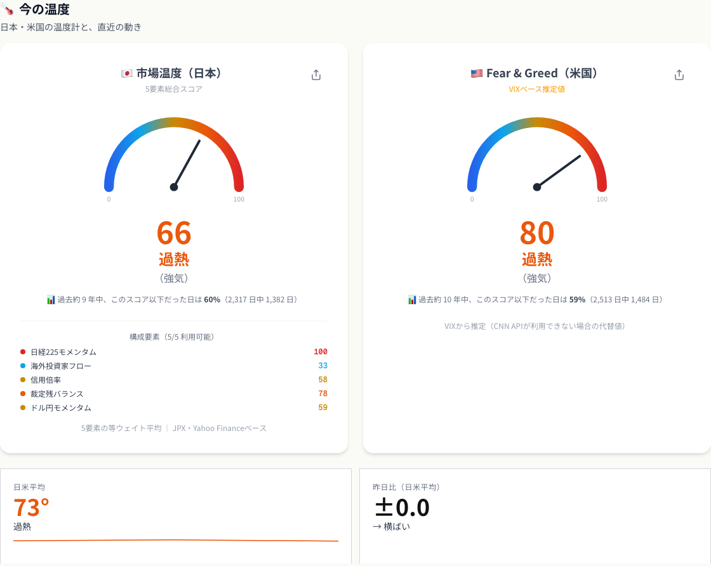
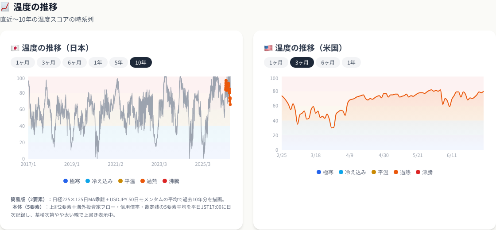
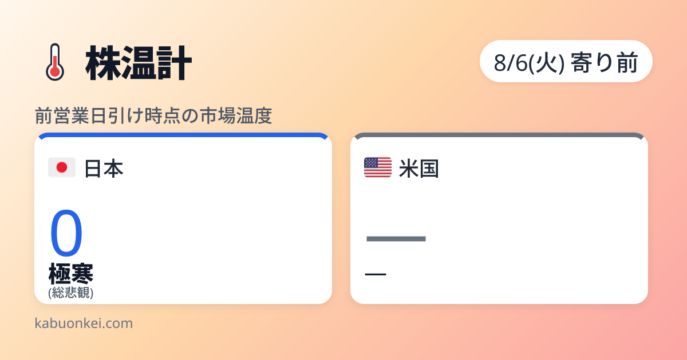
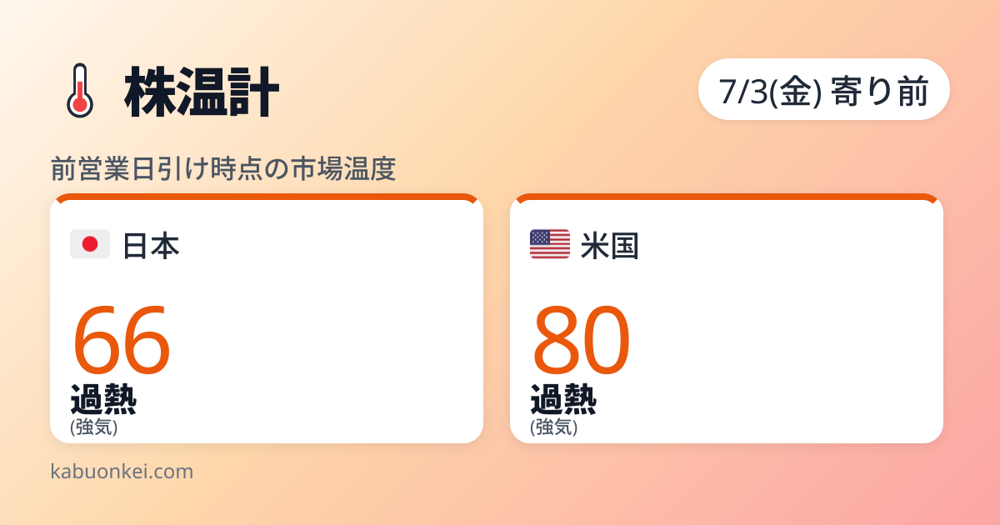

# 日本版「Fear & Greed Index」が無かったので、自分で作った

<!--
タイトルSEOメモ: 日本語訳は「恐怖と欲望指数/恐怖と強欲指数/恐怖と貪欲指数」と媒体で分裂しており、
英語表記が全媒体共通の最大公約数。「日本版 Fear & Greed」は独占を狙うキーワード（競合: kodomo-nisa.jp）。
日本語訳での検索は本文冒頭の「Fear & Greed Index（恐怖と欲望指数）」併記で拾う。
-->

<!--
note投稿用原稿（第1弾）
- データ基準日: 2026-07-01（japan-historical-stats.json generatedAt）
- 温度の現在値: 2026-07-03 時点のサイト表示（5要素版）日本66°・米国80°
- 投稿時の作業: 図版添付（images/ 参照）、markdown表を箇条書きor画像に変換、Xハンドルのプレースホルダを実値に置換
- 図版:
  - アイキャッチ: images/eyecatch-reiwa-black-monday.png（温度0°のカード。8/6寄り前=8/5引け時点）
  - images/gauge-japan.png（今の温度セクション）
  - images/history-10y.png（10年温度推移チャート）
  - images/temperature-card-2026-07-03.png（現在の温度カード）
-->

## あの日、恐怖を測る物差しが欲しかった

2024年8月5日。日経平均は1日で **-12.4%**、4,451円安。ブラックマンデーを超える史上最大の下げ幅で、「令和のブラックマンデー」と呼ばれることになった日です。

SNSは阿鼻叫喚、証券アプリは軒並みサーバーダウン。私はその真っ只中で、ひとつのことを考えていました。

**「今って、歴史的に見てどのくらい怖い日なんだろう？」**

体感では「過去最悪」。でも体感はあてになりません。コロナショックのときも、みんな「世界の終わり」だと思っていました。欲しかったのは、恐怖を**数値で**測る物差しでした。

米国には、それがあります。CNNが公表している **Fear & Greed Index（恐怖と欲望指数）** 。VIXや株価モメンタムなど7つの指標を合成して、市場心理を0（極度の恐怖）〜100（極度の欲望）で表すものです。米国の投資家は暴落のたびにこれを見て、「今の恐怖は歴史的に何点か」を確認しています。

ところが、**日本版は存在しませんでした**。日経平均を見ている日本の個人投資家が数百万人いるのに、日本市場の「体温」を測る計器が無い。

無いなら、作るしかない。そうしてできたのが「**株温計**」という個人開発のWebサイトです。この記事は、その開発記と、作ってみて分かった意外な事実の話です。

## 日本版を作るのに必要だった5つの部品

CNNの合成方法をそのまま日本に持ち込むことはできません。日本にはVIXに相当する使いやすい恐怖指数のデータソースが無く（日経VIはあるのですが、無料で機械的に取れる場所が見つからない）、市場構造も違うからです。

そこで、日本市場で「無料で・毎日・機械的に」取れるデータから、市場心理を映す5つの要素を選びました。

1. **日経225モメンタム** — 125日移動平均からの乖離。トレンドの過熱・悲観
2. **海外投資家フロー** — 直近4週の売買差引累計。東証の売買の約6割は海外勢で、彼らの売り越しはそのまま「日本株への弱気」
3. **信用倍率** — 信用買い残÷売り残。個人投資家の強気度
4. **裁定残バランス** — 先物経由の機関マネーの傾き
5. **ドル円モメンタム** — 50営業日モメンタム。円高ショック＝日本株の恐怖はセットで来る

この5つを等ウェイトで平均し、0〜100の「温度」にします。0°が極度の恐怖（極寒）、100°が極度の欲望（沸騰）。

……と、さらっと書きましたが、実際は泥臭い作業の連続でした。

- CNNのAPIはサーバーからのアクセスをbot検知でブロックしてくる（米国版はVIXからの推定にフォールバックする仕組みを自作）
- 信用倍率や裁定残は **JPXが週次で公表するファイルを加工**する必要がある
- 日本の信用倍率は構造的に高い（平常時で6〜8倍）ので、米国的な感覚で閾値を切ると指標が上限に張り付いて死ぬ。実データを見ながら何度も調整しました

個人開発の市場指標は、データソースとの格闘が9割です。

## 作ってみて分かった、意外な事実

指標ができたら、当然やりたくなるのがバックテストです。

「**温度が極寒だった日に日経平均を買っていたら、どうなっていたのか？**」

過去10年（2016年7月〜2026年7月）、約2,300営業日について、温度帯ごとに「その日に買った場合の1・3・6ヶ月後のリターン」を集計しました（※この過去検証は、長期データが揃う日経225モメンタムとドル円モメンタムの2要素で算出した簡易版スコアです。理由は後述）。

結果がこちらです。

| 温度帯 | 該当日数 | 3ヶ月後 平均リターン | 3ヶ月後 勝率 | 6ヶ月後 平均リターン | 6ヶ月後 勝率 |
|---|---|---|---|---|---|
| 極寒（0-20°） | 111日 | **+11.5%** | **100%** | **+20.6%** | 99.1% |
| 冷え込み（21-40°） | 336日 | +6.8% | 84.1% | +11.5% | 88.7% |
| 平温（41-60°） | 676日 | +3.5% | 57.9% | +5.4% | 59.4% |
| 過熱（61-80°） | 856日 | +1.9% | 54.2% | +3.9% | 53.1% |
| 沸騰（81-100°） | 338日 | +2.7% | 54.7% | +8.5% | 64.7% |

**極寒の日に買った場合、3ヶ月後の勝率は100%（111日中111日）でした。**

正直、集計ミスを疑って3回計算し直しました。しかし何度やっても同じです。温度が低い（=みんなが恐怖している）ほど、その後のリターンは高く、勝率も高い。教科書どおりの「人の行く裏に道あり」が、日本市場の10年分のデータにくっきり刻まれていました。

冒頭の令和のブラックマンデーも、株温計を過去に遡って当てると温度は **0°** 。文字どおりの測定下限でした。そしてその日の日経平均31,458円は、1ヶ月後に+17.8%、3ヶ月後に+22.3%になっています。

あの日いちばん怖かった瞬間が、あとから見ればいちばんの買い場だった——。これはコロナショックでも、2018年のクリスマス暴落でも、2025年の関税ショックでも、同じパターンで繰り返されています。

## ただし、うのみにしてはいけない理由

ここまで読んで「極寒で買えば必勝じゃん」と思った方のために、この統計の限界も正直に書いておきます。むしろここが本題です。

- **「111日」は独立な111回ではありません。** 極寒の日は暴落局面に連続して発生するので、実質的には8回程度の暴落イベントを見ているにすぎません。サンプルは見た目より遥かに少ない
- **この10年は、結果的に右肩上がりの10年でした。** バブル崩壊後の日本のような「下げてからさらに10年下げる」相場では、この統計は成立しなかったはずです
- **過去検証は2要素の簡易版スコアです。** 信用倍率や海外投資家フローの長期履歴は個人では入手できず、5要素フルバージョンの過去再現はできていません
- そして何より、**過去そうだったという統計であって、未来を保証するものではありません**

それでも、「今の恐怖が歴史的に何点なのか」を知ってから判断するのと、体感だけで狼狽するのとでは、大きな差があると思っています。物差しは、答えではなく前提です。

## いま、温度は何度か

ちなみにこの記事を書いている2026年7月3日時点、日経平均は68,733円（7/2終値）で、株温計の温度は **日本66°（過熱）、米国80°（過熱）** 。日米そろって「欲望」側に傾いた水準です。

過熱が即座に暴落を意味するわけではありません（上の表のとおり、過熱帯のその後リターンもプラス寄りです）。ただ、10年に数回の「極寒の買い場」は、必ず全員が恐怖している最中にやってきます。そのとき冷静に温度計を見られるかどうかが、たぶん一番の分かれ目です。

次回は、この「極寒で買うと勝率100%」を、期間別・暴落イベント別にもっと細かく検証します。

---

## 株温計はこちら

- 🌡️ **株温計** — 日本市場と米国市場の「今日の温度」を毎日更新しています
  https://kabuonkei.com/?utm_source=note&utm_medium=article&utm_campaign=note-001
- 🐦 **X で毎朝、今日の温度を投稿しています** → （Xアカウントリンクを挿入）
- 📧 **温度アラート** — 温度が極端（20°以下 / 80°以上）になったときだけメールでお知らせ（無料）
  https://kabuonkei.com/alerts?utm_source=note&utm_medium=article&utm_campaign=note-001

※本記事は情報提供を目的としたものであり、特定の金融商品の売買を推奨するものではありません。投資判断はご自身の責任でお願いします。
