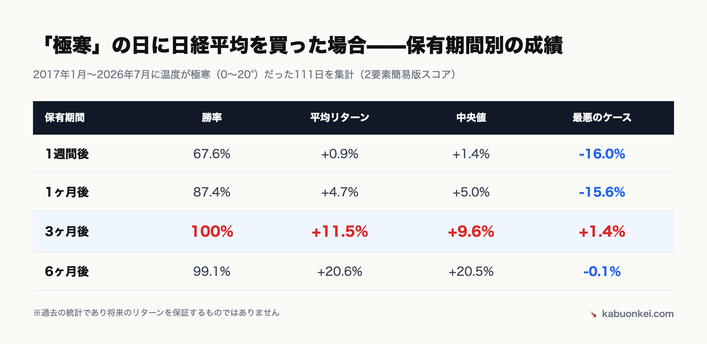
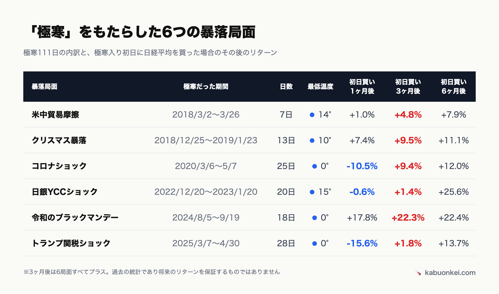
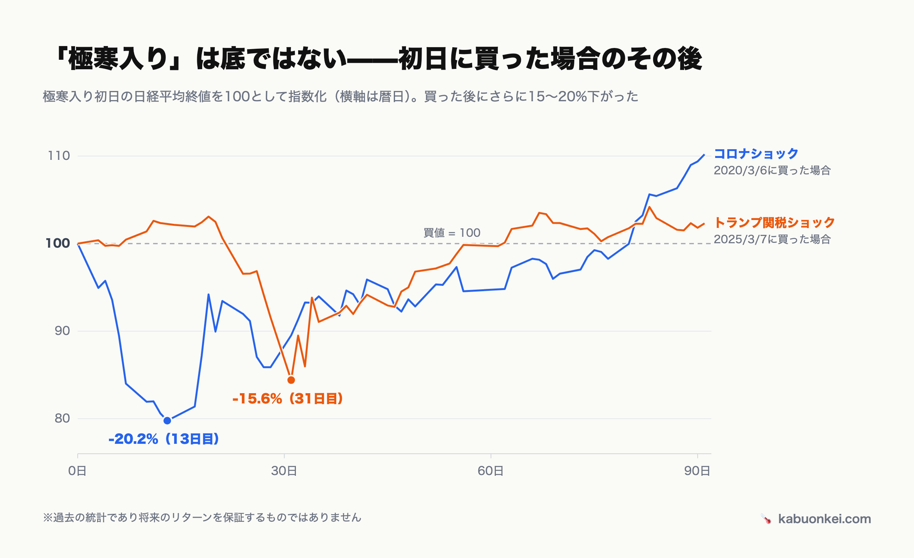
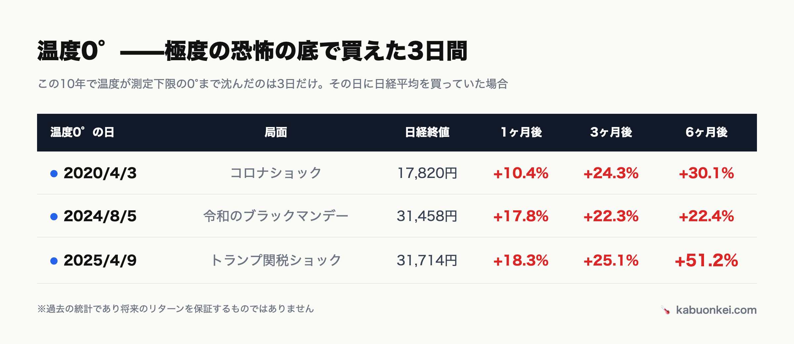

# 「極寒で買えば勝率100%」を疑え——111日ぶんの中身を全部バラしてみた

<!--
タイトルSEOメモ: 第1弾のフック回収回。狙いは検索よりも note 内回遊とX拡散
（「勝率100%」への健全な懐疑を自分で先にやってみせる構成）。
代替タイトル案:
- 市場が「極寒」の日に日経平均を買っていたら？——勝率100%の中身を解剖する（ロードマップ原案）
- 勝率100%の買いシグナル、その「100%」を作っている6つの暴落
-->

<!--
note投稿用原稿（第2弾）
- データ基準日: 2026-07-07（japan-temperature-history.json generatedAt。全2,317営業日・極寒111日）
- 集計ロジック: scripts/_lib/shared.ts の findForwardPrice と同一（カレンダー30/90/180日後に最も近い取引日、7日以内に取引日が無ければ除外）。
  温度帯別の集計値は公開中の japan-historical-stats.json（極寒111日・3ヶ月後 +11.5%/勝率100%・6ヶ月後 +20.6%/99.1%）と一致確認済み
- 温度の現在値: 2026-07-07 時点の本体5要素版 日本67°（過熱）、日経平均 68,256円
- 投稿時の作業: 図版添付（images/ 参照）、markdown表を削除して表画像に置換、Xハンドルのプレースホルダを実値に置換
- 図版（作成済み。スタイル付き HTML を headless browser で 2x 撮影）:
  - アイキャッチ: images/note002-eyecatch.png（タイトル + 保有期間別勝率の棒チャート、1280×670）
  - images/note002-period-table.png（検証1: 期間別テーブル）
  - images/note002-episode-table.png（検証2: 6暴落イベント別テーブル）
  - images/note002-entry-drawdown.png（検証3: コロナ/関税ショックの極寒入り後の追加下落チャート）
  - images/note002-zero-days-table.png（検証4: 温度0°の3日テーブル）
-->

## 「勝率100%」なんて言葉、普通は詐欺です

前回の記事で、こんな検証結果を書きました。

> 日本市場の「温度」が**極寒（0〜20°）**だった日に日経平均を買っていた場合、**3ヶ月後の勝率は100%（111日中111日）** だった——

「日本版Fear & Greed Index」を自作した話の中で出てきた数字です。過去約10年・2,317営業日をバックテストした結果で、何度計算し直しても同じでした。

でも正直に言うと、書いた本人が一番この数字を疑っています。投資の世界で「勝率100%」という言葉が出てきたら、まず疑うのが正しい態度です。たいていは、都合の悪い部分がどこかに隠れています。

そこで今回は、この「勝率100%」を**解剖**します。111日の中身を全部バラして、都合の悪い部分がどこに隠れているのかを、先回りして自分で暴いておく回です。

先に結論を書いてしまいます。

- 勝率100%は本当。ただしそれは「**買ってから3ヶ月待てた人**」の数字
- 111日の正体は、たった**6つの暴落局面**
- 極寒入りのサインは「底」ではない。**買った後にさらに最大20%下がった**局面がある
- そして、いちばん怖かった日（温度0°）に買った人が、いちばん報われている

順番に見ていきます。

## おさらい: 「極寒」とは何か

「株温計」は、日本市場のセンチメントを0〜100の温度で毎日測っている個人開発サイトです。0°が極度の恐怖、100°が極度の欲望。このうち**20°以下を「極寒」**と呼んでいます。

過去約10年（2017年1月〜2026年7月、スコアを算出できる2,317営業日）で、極寒だった日は**111日**。全営業日のわずか**4.8%**、年平均で12日ほどしかありません。市場が本気で恐怖に沈む日は、それくらい珍しいということです。

※過去検証のスコアは前回同様、長期データが揃う2要素（日経225モメンタム＋ドル円モメンタム）の簡易版です。

## 検証1: 「3ヶ月」をズラすと勝率はどう変わるか

まず時間軸の解剖から。「3ヶ月後の勝率100%」の**3ヶ月**という部分を動かしてみます。極寒111日それぞれについて、買ってから1週間後・1ヶ月後・3ヶ月後・6ヶ月後の日経平均のリターンを集計しました。

<!-- ↓ この markdown 表は GitHub レビュー用。note は表非対応のため、投稿時は上の画像だけを使い、この表は削除する -->

| 保有期間 | 勝率 | 平均リターン | 中央値 | 最悪のケース |
|---|---|---|---|---|
| 1週間後 | 67.6% | +0.9% | +1.4% | **-16.0%** |
| 1ヶ月後 | 87.4% | +4.7% | +5.0% | **-15.6%** |
| 3ヶ月後 | **100%** | +11.5% | +9.6% | +1.4% |
| 6ヶ月後 | 99.1% | +20.6% | +20.5% | -0.1% |

一目瞭然です。**1週間後の勝率は67.6%しかありません**。極寒の日に買っても、3回に1回は1週間後にマイナスです。最悪のケースは1週間で**-16%**。暴落の真っ只中で買うというのは、そういうことです。

1ヶ月後でも勝率は87.4%止まり。それが3ヶ月後になると、最悪のケースですら**+1.4%**になります。

つまり「勝率100%」の正体はこうです——**極寒で買うと必ずすぐ儲かる、のではない。極寒で買って3ヶ月耐えた人が、結果的に全員救われていた**。この10年に関する限り、報酬は「買う勇気」ではなく「持ち続ける忍耐」に支払われていました。

ちなみに6ヶ月後の勝率が99.1%と、3ヶ月後より下がっているのに気づいたでしょうか。111日中たった1日だけ、6ヶ月後にマイナスだった日があります。2024年9月12日、令和のブラックマンデーの余震で極寒に沈んだ日です。この日の6ヶ月後は2025年3月——**次の暴落（トランプ関税ショック）の真っ最中**でした。それでも損益は**-0.11%**、ほぼ引き分けです。唯一の「負け」が、次の暴落に着地してなおこの水準でした。

## 検証2: 111日の正体は、たった6つの暴落

次に「111日」を解剖します。前回も書いたとおり、極寒の日は暴落局面に連続して発生するので、111日は独立な111回ではありません。日付を全部並べてクラスタリングすると、正体は**6つの暴落局面**でした（前回「実質8回程度」と書きましたが、正確に数え直したら6回でした。訂正します）。

<!-- ↓ GitHub レビュー用。投稿時は画像に置換 -->

| 暴落局面 | 極寒だった期間 | 日数 | 最低温度 | 初日に買った場合 1ヶ月後 | 3ヶ月後 | 6ヶ月後 |
|---|---|---|---|---|---|---|
| 米中貿易摩擦 | 2018/3/2〜3/26 | 7日 | 14° | +1.0% | +4.8% | +7.9% |
| クリスマス暴落 | 2018/12/25〜2019/1/23 | 13日 | 10° | +7.4% | +9.5% | +11.1% |
| コロナショック | 2020/3/6〜5/7 | 25日 | **0°** | **-10.5%** | +9.4% | +12.0% |
| 日銀YCCショック | 2022/12/20〜2023/1/20 | 20日 | 15° | -0.6% | +1.4% | +25.6% |
| 令和のブラックマンデー | 2024/8/5〜9/19 | 18日 | **0°** | +17.8% | +22.3% | +22.4% |
| トランプ関税ショック | 2025/3/7〜4/30 | 28日 | **0°** | **-15.6%** | +1.8% | +13.7% |

この表から読み取れることが2つあります。

ひとつは、**サンプルは111ではなく実質6**だということ。「勝率100%」は統計的には「6連勝」程度の重みしかありません。コインを6回投げて全部表が出る確率は約1.6%なので偶然とは考えにくいものの、「111戦111勝」が与える印象よりは、ずっと弱い証拠です。

もうひとつは、6局面すべてで、極寒初日に買っても**3ヶ月後にはプラス圏に戻っている**こと。最悪の日銀YCCショックですら+1.4%です。勝率100%は特定の1回の暴落が作った数字ではなく、性質の違う6つの暴落——貿易戦争、利上げ、パンデミック、金融政策サプライズ、円キャリー巻き戻し、関税——で毎回成立していました。ここは素直に、この指標の強みだと思っています。

## 検証3: 「極寒入り」は底ではない

ただし、表の1ヶ月後の列を見てください。コロナショック**-10.5%**、トランプ関税ショック**-15.6%**。極寒に入った初日に買うと、そこからさらに深く突き刺さった局面が2つあります。

極寒入りの初日に買った場合、そこから底までの「追加の下落」はこうでした。

- コロナショック: 2020/3/6に20,750円で極寒入り → 3/19の底16,553円まで**さらに-20.2%**
- トランプ関税ショック: 2025/3/7に36,887円で極寒入り → 4/7の底31,137円まで**さらに-15.6%**
- 一方、令和のブラックマンデーとクリスマス暴落は**極寒入りした日がほぼ底**でした

つまり6回中2回は「初日が底」、2回は「底の近く（-3%以内）」、そして2回は「そこから2割落ちた」。**極寒入りのサインは「底に着いた」ではなく「底の近所に来た」**と読むのが正確です。近所といっても、コロナの近所は半径20%ありました。

これが、検証1で見た「1週間後の勝率67.6%」の正体でもあります。3ヶ月後の勝率100%という結果だけ見ると簡単に思えますが、その3ヶ月の中身は、含み損-20%の画面を見ながら耐える日々だったかもしれないわけです。

## 検証4: いちばん怖い日が、いちばん報われた

最後に、温度の「深さ」で解剖します。この10年で温度が**0°**——測定下限、極度の恐怖の底——まで沈んだ日は、たった3日しかありません。その3日に買っていた場合の成績がこちらです。

<!-- ↓ GitHub レビュー用。投稿時は画像に置換 -->

| 温度0°の日 | 局面 | 日経終値 | 1ヶ月後 | 3ヶ月後 | 6ヶ月後 |
|---|---|---|---|---|---|
| 2020/4/3 | コロナショック | 17,820円 | +10.4% | +24.3% | +30.1% |
| 2024/8/5 | 令和のブラックマンデー | 31,458円 | +17.8% | +22.3% | +22.4% |
| 2025/4/9 | トランプ関税ショック | 31,714円 | +18.3% | +25.1% | **+51.2%** |

3日とも、1ヶ月後には+10%を超え、6ヶ月後は+22%〜+51%。極寒全体の平均（1ヶ月後+4.7%、6ヶ月後+20.6%)を大きく上回ります。**恐怖が深いほど、その後のリターンは大きい**。検証1〜3で散々「そんなに甘くない」と書いてきましたが、この関係だけは気持ちいいくらいに一貫していました。

ただし、これを「じゃあ0°まで待って買えばいい」と読むのは間違いです。表をもう一度見てください。米中貿易摩擦は14°、クリスマス暴落は10°、日銀YCCショックは15°までしか下がりませんでした。**0°を待っていたら、6回の買い場のうち3回は永遠に来ません**。深さは事前には分からないのです。

## で、どう使えばいいのか

検証結果をまとめると、こうなります。

1. 極寒で買って3ヶ月待つと、この10年では全勝だった（ただし実質6連勝）
2. ただし買った直後は普通に下がる。最大でさらに-20%
3. 底の深さ（0°まで行くか、15°で止まるか）は事前には分からない

私はこの結果を、「極寒になったら**一括で底を当てにいくのではなく、さらに下がることを織り込みながら、時間を分けて拾い始めるサイン**」と解釈しています。極寒は年平均12日しかありません。10年に数回のその局面で、体感の恐怖に流されて何もできないか、温度計を見て「歴史的にはここが仕込み場だった」と思い出せるか。物差しの価値はそこにあると思っています。

念のため、前回と同じ免責をここでも。**これは過去10年（結果的に右肩上がりだった10年）の統計であって、未来を保証するものではありません**。サンプルは実質6回。7回目の暴落が同じパターンをたどる保証は、どこにもありません。

## いま、温度は何度か

この記事を書いている2026年7月7日時点、日経平均は68,257円、株温計の日本市場温度は**67°（過熱）**です。極寒とは正反対の、欲望側に傾いた水準にいます。

次の極寒がいつ来るかは誰にも分かりません。ただ、来たときにこの記事の表を思い出せるように、株温計は毎日温度を測り続けています。

次回は視点を米国に移して、「VIXが30を超えた日、S&P500はどう動いたか」を検証します。恐怖指数の本家・米国版でも「人の行く裏に道あり」は成立しているのか。

---

## 株温計はこちら

- 🌡️ **株温計** — 日本市場と米国市場の「今日の温度」を毎日更新しています。この記事の温度帯別統計もトップページでいつでも最新版を見られます
  https://kabuonkei.com/?utm_source=note&utm_medium=article&utm_campaign=note-002
- 🐦 **X で毎朝、今日の温度を投稿しています** → （Xアカウントリンクを挿入）
- 📧 **温度アラート** — 温度が極端（20°以下 / 80°以上）になったときだけメールでお知らせ（無料）
  https://kabuonkei.com/alerts?utm_source=note&utm_medium=article&utm_campaign=note-002

※本記事は情報提供を目的としたものであり、特定の金融商品の売買を推奨するものではありません。投資判断はご自身の責任でお願いします。
