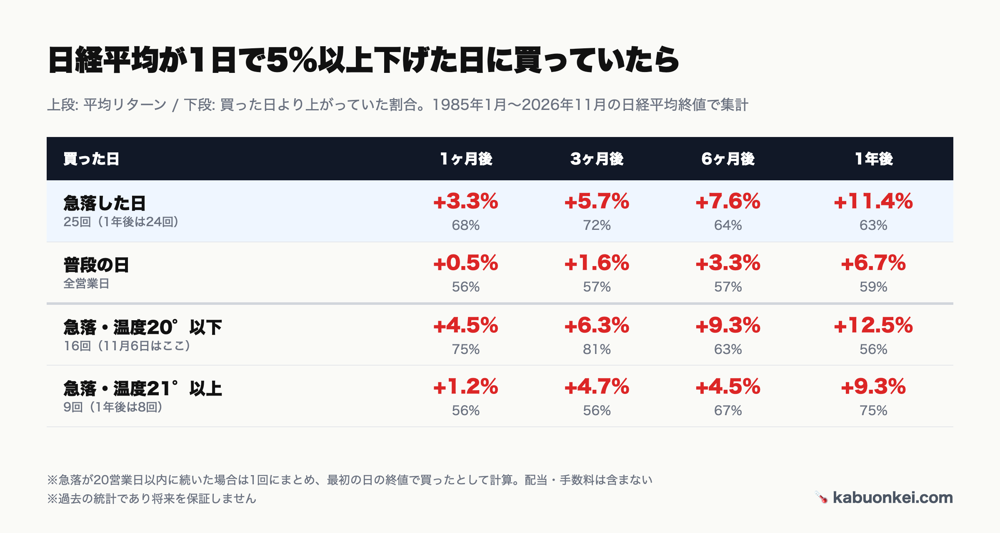
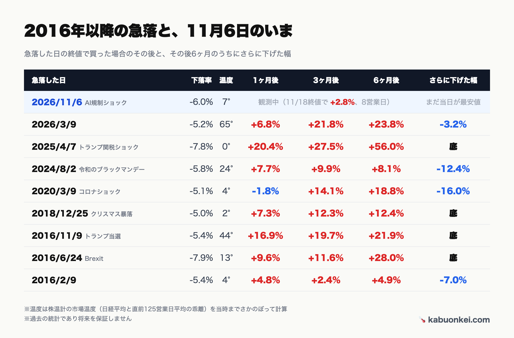

# 日経平均が1日で-6%。11月6日は「底」だったのか——1985年以降の急落26回、その後を全部追った

<!--
タイトルメモ: 11/06（AI規制ショック）直後の「暴落はいつまで」「いまは買い時か」の関心を拾う号外回。
サイトの分析記事 /analysis/nikkei-crash-aftermath を note 向けに転用し、11/06 の現在地を足した構成。
代替タイトル案:
- 「急落の日に買えば儲かる」は本当か——日経平均の急落26回、底だったのはたった4回
- 日経平均-6%の翌週に読む。過去の急落26回は、そのあと何%下げたか
-->

<!--
note投稿用原稿（第3弾）
- 位置づけ: ロードマップでは 003 を「VIXが30を超えた日」としていたが、11/06 の急落の話題性を活かすため
  号外的にこの記事を 003 に前倒し（README の「相場急変時は号外的に前倒し可」）。VIX 回は 004 に繰り下げ
- データ基準日: 2026-11-18（nikkei-crash-analysis.json generatedAt。1985-01-02〜2026-11-18 の日経平均終値。
  急落日46日・26回、6ヶ月経過は25回）。11/06 以降の終値・温度は japan-temperature-history.json（同日 generatedAt）
- 集計ロジック: scripts/_lib/nikkei-crash.ts の computeNikkeiCrashAnalysis()（サイト記事と同一）。
  本文の補足値（底までの日数の分布、1ヶ月後プラス→6ヶ月後マイナスの回数、11/06 の水準の試算）は
  同 JSON の episodes から手計算（2026-11-18）
- 温度は新定義（日経225 と直前125営業日平均の乖離、2026-11-17〜）。過去分もこの定義でさかのぼって計算
- 投稿時の作業: 図版添付（images/ 参照）、markdown 表を削除して表画像に置換。
  投稿日が 11/18 から数日ずれる場合は「11月6日は、いまどこにいるか」の 11/18 の数字（終値・温度・経過営業日数）を
  最新値に更新し、図版 note003-recent-table.png の 1 行目も撮り直す（ソースは images/src/note003-recent-table.html）。
  12/1 の月次再生成では 11/06 の回はまだ1ヶ月たたないため集計値は変わらない（11/06 の1ヶ月後の値が集計に入るのは 2027-01-01 の再生成）
- 公開前に /analysis/nikkei-crash-aftermath が本番で表示されることを確認（PR #152 で 2026-11-18 マージ済み）
- X bot は 2026-11-06 から停止中のため、末尾フッターの X 導線は外してある（再開したら戻す）
- 図版（スタイル付き HTML を headless browser で 2x 撮影。HTML ソースは images/src/）:
  - アイキャッチ: images/note003-eyecatch.png（タイトル + 「急落した日が底だったのは25回中4回」、1280×670）
  - images/note003-returns-table.png（検証1・3: 急落した日 vs 普段の日 / 温度別）
  - images/note003-recent-table.png（2016年以降の急落と 11/06 の現在地）
-->

## 11月6日、日経平均は1日で-5.96%下げた

2026年11月6日、日経平均は前日比**-3,643円（-5.96%）**、終値**57,434円**で取引を終えました。下げ幅は歴代3位です。

きっかけは11月3日の米中間選挙でした。AI規制に前向きとされる民主党が上下両院の過半数を取り、データセンター建設が鈍るのではという懸念が広がって、前日の米国市場で半導体株が大きく売られました。日経平均はその流れを受け、ソフトバンクグループやアドバンテストなど、ここ数年の上昇を引っぱってきた銘柄が下げの中心になりました。株温計の日本市場の温度は**7°**。極寒（20°以下）で、2025年4月のトランプ関税ショック以来の低さです。

急落した日に気になるのは、たいていこの2つです。

- **これは買い場なのか**
- **まだ下がるのか**

どちらも、その日のうちに答えが出る問いではありません。ただ、「過去に同じくらい下げた日のあと、株価がどう動いたか」なら調べられます。そこで、1985年以降に日経平均が1日で5%以上下げた日を全部洗い出して、その後を追いかけてみました。

先に結論を書きます。

- 1985年以降、1日で5%以上下げた日は**46日**、続けて起きたものをまとめると**26回**。急落した日の終値で買うと、3ヶ月後は平均**+5.7%**（上がっていた割合72%）で、普段の日に買った場合（+1.6%、57%）より成績は良かった
- ただし**急落した日がそのまま底だったのは、25回中4回だけ**。残りはその後もさらに下げていて、下げ幅は中央値で**-7.5%**、平均で**-10.5%**
- 11月6日のように温度が20°以下のときの急落は、3ヶ月後に上がっていた割合が**81%（16回中13回）**。ただし1年後になると56%まで下がる
- **1ヶ月後に戻っていても安心はできない**。6ヶ月後にマイナスだった9回のうち6回は、1ヶ月後の時点ではプラスだった

順番に見ていきます。

## 調べ方

使ったのは、1985年1月から2026年11月18日までの日経平均の終値です。

- **急落の日**: 終値が前の日より5%以上下がった日（46日）
- **1回の急落としてまとめる**: 前の急落から20営業日（約1ヶ月）以内に起きた急落は同じ1回として、その最初の日に買ったことにする（26回）。リーマン・ショックのように急落が何日も続いた時期を何度も数えないためです
- **その後のリターン**: 急落した日の終値から、約1ヶ月後・3ヶ月後・6ヶ月後・1年後（21・63・126・252営業日後）の終値まで。配当は含みません
- **温度**: 株温計のトップページと同じ定義（日経平均と、直前125営業日の平均との差を0〜100にしたもの）を、1985年までさかのぼって計算

「下げ幅は歴代3位」と聞くとかなり異常な日に思えますが、いまの日経平均は6万円前後なので、同じ率でも円で見た下げ幅は大きく出ます。**率で見ると、5%以上の下げは41年間で46日**。珍しいものの、前例のない下げではありません。

## 検証1: 急落の後、株価は上がったか

急落した日に買った場合と、期間中のどの日でも買った場合（普段の日）を比べました。

<!-- ↓ この markdown 表は GitHub レビュー用。note は表非対応のため、投稿時は上の画像だけを使い、この表は削除する -->

| 買った日 | 1ヶ月後 | 3ヶ月後 | 6ヶ月後 | 1年後 |
|---|---|---|---|---|
| 急落した日（25回、1年後は24回） | +3.3%（68%） | +5.7%（72%） | +7.6%（64%） | +11.4%（63%） |
| 普段の日（全営業日） | +0.5%（56%） | +1.6%（57%） | +3.3%（57%） | +6.7%（59%） |
| 急落・温度20°以下（16回） | +4.5%（75%） | +6.3%（81%） | +9.3%（63%） | +12.5%（56%） |
| 急落・温度21°以上（9回、1年後は8回） | +1.2%（56%） | +4.7%（56%） | +4.5%（67%） | +9.3%（75%） |

（かっこ内は、買った日より値上がりしていた割合）

平均で見ると、どの期間でも**急落した日に買ったほうが成績は良かった**です。3ヶ月後で比べると、平均リターンは普段の日の3倍以上あります。

ただ、上がっていた割合を見ると話が少し変わります。3ヶ月後は72%と普段の日（57%）をはっきり上回りますが、1年後は63%で、普段の日の59%とほとんど変わりません。急落の日に買うことの「得」は、**数ヶ月の戻りに集中していて、1年たつと普段の日との差は小さくなる**、というのが正直な見え方です。

## 検証2: 急落した日は底だったか

「まだ下がるのか」のほうに答えるのがこの検証です。6ヶ月たった25回について、急落した日の終値が、その後6ヶ月で一番安い値だったかを調べました。

結果は**25回中4回**。急落した日がそのまま底だったのは、この4回だけでした。

- 2016年6月24日（Brexit、英国の国民投票でEU離脱が決まった日）
- 2016年11月9日（トランプ氏の大統領選勝利）
- 2018年12月25日（クリスマス暴落）
- 2025年4月7日（トランプ関税ショック）

残りの21回は、急落した日のあともさらに下げています。その後6ヶ月の一番安い値までの下げ幅は、中央値で**-7.5%**、平均で**-10.5%**。一番安くなったのは、中央値で急落から**26営業日後（1ヶ月と少し）**でした。

もう少し細かく見ると、底のタイミングは2つに分かれていました。

- **急落から2ヶ月以内に底をつけた回**: 15回。2024年8月2日（令和のブラックマンデーの前の営業日）は翌営業日にさらに-12.4%、2020年3月9日（コロナショック）は8営業日後にさらに-16.0%まで下げてから戻りました
- **4ヶ月以上たってから底をつけた回**: 10回。1990年のバブル崩壊、2000〜2001年のITバブル崩壊、2007〜2008年のサブプライム問題からリーマン・ショックなど、**何年も続いた下げ相場の入り口**だった回です

急落は「買い場の入り口」にはなりやすいものの、「底」を当てるのはほぼ無理、というのがこの検証のいちばん実用的な結論です。

## 検証3: 温度が低いときの急落は違うか

同じ-5%でも、すでに下げが続いて市場が冷えていたときと、高値圏から急に落ちたときでは意味が違うはずです。急落した日の温度で分けたのが、検証1の表の下2段です。

11月6日は7°だったので、**20°以下のグループ（16回）**に入ります。このグループは、3ヶ月後に上がっていた割合が**81%（16回中13回）**。21°以上のときの急落（56%、9回中5回）よりはっきり高くなっています。売られすぎたところにもう一段の投げ売りが出た形で、そのあと戻りやすかったと考えられます。

ところが1年後になると逆転して、20°以下は56%、21°以上は75%です。20°以下で急落した回の中に、1990年、2007年、2008年のような長い下げ相場の途中の回が入っていて、それが足を引っぱっています。**温度が低いことは「短期の戻り」には効いていたが、「長い下げ相場ではない」ことまでは教えてくれない**、ということです。

どちらも16回と9回しかないので、温度だけで判断できるほどの差ではない点も書いておきます。

## 外れた例: 6ヶ月後もマイナスだった9回

25回のうち、6ヶ月後も急落した日より安かったのは9回あります。

- 1990年4月2日（-6.6%、温度0°）→ 6ヶ月後 -27.8%
- 1991年8月19日（-6.0%、温度1°）→ 6ヶ月後 -0.4%
- 1995年1月23日（-5.6%、温度16°、阪神・淡路大震災の後）→ 6ヶ月後 -6.7%
- 1997年11月19日（-5.3%、温度0°）→ 6ヶ月後 -0.3%
- 2000年4月17日（-7.0%、温度50°）→ 6ヶ月後 -21.8%
- 2001年3月29日（-5.0%、温度25°）→ 6ヶ月後 -25.2%
- 2007年8月17日（-5.4%、温度6°）→ 6ヶ月後 -9.5%
- 2008年10月8日（-9.4%、温度0°、リーマン・ショック）→ 6ヶ月後 -4.9%
- 2011年3月14日（-6.2%、温度36°、東日本大震災の後）→ 6ヶ月後 -11.5%

ここでいちばん伝えたいのは、**この9回のうち6回は、1ヶ月後の時点ではプラスだった**ことです。1990年4月2日は1ヶ月後+7.8%、3ヶ月後には+15.8%まで戻っていたのに、6ヶ月後は-27.8%でした。2001年3月29日も1ヶ月後は+6.6%でした。

「急落のあとすぐ戻ったから、もう大丈夫」とは、過去のデータからは言えません。

## 11月6日は、いまどこにいるか

ここからは11月6日の話に戻ります。11月18日の終値までで、急落から8営業日がたちました。

- 日経平均は翌営業日から3日続けて上がり、11月11日には**61,248円**と急落前日の終値（61,077円）を上回りました
- その後はまた下げて、11月18日の終値は**59,024円**。急落した日の終値からは**+2.8%**です
- 温度は 7°（11/6）→ 27°（11/11）まで戻ったあと、11月17日に15°、18日に16°と、**再び極寒に入っています**
- 急落した日の終値（57,434円）は、いまのところ**まだ一番安い終値**です

つまり今の時点では、11月6日は「急落した日がそのまま底だった4回」の仲間になる可能性も、まだ残っています。

一方で、検証2の中央値をそのまま当てはめるとどうなるか、目安として計算しておきます。急落した日の終値からさらに-7.5%下げるとすると**約53,100円**、平均の-10.5%なら**約51,400円**。中央値の「26営業日後」は**12月15日ごろ**にあたります。もちろんこれは予想ではなく、過去の真ん中くらいの回と同じ動きをしたら、という計算にすぎません。

もうひとつ、表を見ていて気になったことがあります。急落した日がそのまま底だった4回のうち3回（Brexit、トランプ氏の当選、関税ショック）は、国民投票や選挙、関税の発表といった**政治のイベントがきっかけ**でした。11月6日も選挙がきっかけです。ただ、今回はこれからAI規制の中身が決まっていく段階で、「結果が出て不安が晴れた」形ではありません。そもそも4回では何も言えないので、ここは「気になった」以上のことは書かないでおきます。

## で、どう使えばいいのか

検証結果をまとめると、こうなります。

1. 急落した日に買うと、数ヶ月後の成績は普段の日より良かった（ただし1年後は差が小さい）
2. 急落した日が底だったのは25回中4回。中央値でさらに-7.5%下げ、底は1ヶ月と少し先だった
3. 温度が低いときの急落は短期では戻りやすかったが、長い下げ相場の入り口かどうかまでは分からない
4. すぐ戻っても、半年後にまた安くなっていた回がある

私はこの結果を、**「急落の日に一度に全部買うより、何回かに分けて買うほうが、過去の値動きには合っている」**と受け取っています。急落は買い場の入り口になりやすいけれど、入り口から底までは平均で1割ほどあり、その先がもっと長い下げ相場だった回もある。分けて買っておけば、底がどこでも「全部を一番高いところで買う」ことは避けられます。

前回の記事（「極寒で買えば勝率100%」を疑え）でも、極寒入りのサインは「底に着いた」ではなく「底の近所に来た」と書きました。今回、41年ぶんの急落で調べ直しても、同じ形の結論になりました。

念のため、いつもの免責も。**これは過去の統計であって、未来を保証するものではありません**。急落は26回しかなく、1回の大きな当たり外れで平均が動きます。また、急落した日の終値で買えたとして計算していますが、実際に急落の日の引けで買うのは簡単ではありません。

急落の全件一覧（26回すべての日付・温度・その後のリターン・さらに下げた幅）は、サイトの分析記事にまとめています。新しい急落が起きると、毎月1日の更新で自動的に一覧に入ります。11月6日がどうなったかも、そこで追いかけられます。

https://www.kabuonkei.com/analysis/nikkei-crash-aftermath?utm_source=note&utm_medium=article&utm_campaign=note-003

前回予告していた「VIXが30を超えた日、S&P500はどう動いたか」は、今回の急落を優先したため次回に回します。

---

## 株温計はこちら

- 🌡️ **株温計** — 日本市場と米国市場の「今日の温度」を毎日更新しています
  https://www.kabuonkei.com/?utm_source=note&utm_medium=article&utm_campaign=note-003
- 📉 **AI規制ショック（2026年11月6日）の記録** — その日に何が起きたかと、その後の値動き
  https://www.kabuonkei.com/events/ai-regulation-shock-2026?utm_source=note&utm_medium=article&utm_campaign=note-003
- 📧 **温度アラート** — 温度が極端（20°以下 / 80°以上）になったときだけメールでお知らせ（無料）
  https://www.kabuonkei.com/alerts?utm_source=note&utm_medium=article&utm_campaign=note-003

※本記事は情報提供を目的としたものであり、特定の金融商品の売買を推奨するものではありません。投資判断はご自身の責任でお願いします。
