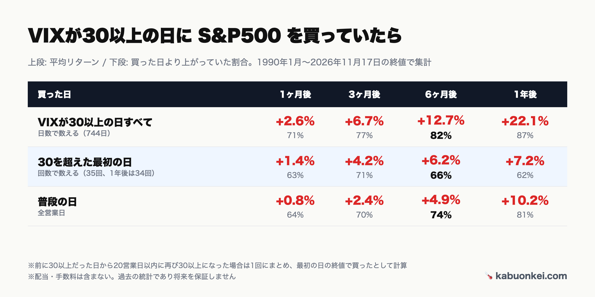
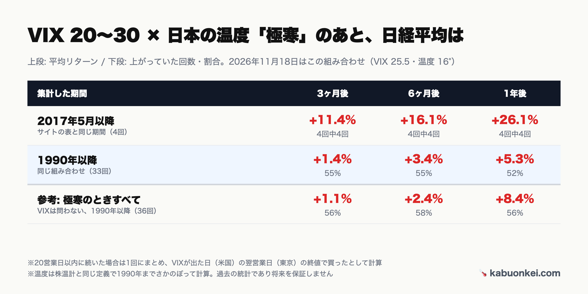

# VIXが30を超えた日、S&P500はどう動いたか——「6ヶ月後の勝率82%」を、数え方から疑ってみた

<!--
タイトルメモ: 002 の末尾で予告した「VIXが30を超えた日」の回。サイトの /analysis/vix-threshold-sp500 の結論
（VIX が高いほど S&P500 の6ヶ月後勝率が高い、30以上で82%）を、002 と同じく自分で疑ってみせる構成。
11/06（AI規制ショック）以降の「VIX 20〜30 × 日本の極寒」という今の組み合わせをフックに使う。
代替タイトル案:
- 「VIX30超えは買い場」は本当か——1990年以降の35回を1回ずつ数え直したら、勝率は普段より低かった
- 恐怖指数VIXが30を超えた35回、その後のS&P500と日経平均を全部追った
-->

<!--
note投稿用原稿（第4弾）
- データ基準日: 2026-11-18。Yahoo Finance の ^VIX / ^GSPC（1990-01-02〜2026-11-17 の米国終値）と
  ^N225（〜2026-11-18）を取得して集計（一時スクリプトで計算。リポジトリには残していない）
- 集計ロジック:
  - 前方リターンはサイト記事 /analysis/vix-threshold-sp500 と同じ（scripts/_lib/shared.ts の findForwardPrice。
    カレンダー30/90/180/365日後に最も近い取引日の終値）。1年後（365日）はこの記事で追加
  - 「1回」のまとめ方は 003 と同じ: VIX 終値が30以上の日のうち、前の30以上の日から20営業日以内のものは同じ1回とし、
    最初の日の終値で買ったことにする（744日 → 35回）
  - 「さらに下げた幅」: 最初の日の S&P500 終値から、その後180カレンダー日以内の最安終値まで
  - 日経平均は、VIX が出た日（米国の日付）の翌営業日（東京）の終値で買ったことにする（米国の引けは日本時間の翌朝のため）。
    サイト記事は同じ日付どうしで比べているので、日経平均の数字はサイトと少しずれる
  - 日本の温度は新定義（日経225 と直前125営業日平均の乖離）を 1990 年までさかのぼって計算
    （scripts/_lib/japan-temperature.ts の computeJapanTemperatureSeries と同じ）。
    組み合わせ（VIX × 温度）は、VIX（米国の日付）と、その翌営業日（東京）の温度を組み合わせる
- サイト記事の「VIX 30以上 → S&P500 6ヶ月後 +13.3% / 勝率81.7%（449日）」「20〜30 × 極寒 → 日経225 6ヶ月後 勝率100%（13日）」は
  vix-sp500-analysis.json（2026-11-17 生成、2006-11〜の20年・組み合わせは2017-05〜）の値。
  この記事では 1990 年からで数え直しており、日数ベースの勝率（82%）はサイトとほぼ一致
- 出来事の呼び名（湾岸危機・アジア通貨危機・リーマン・ショックなど）は日付と照らして付けたもの。投稿前に人間の目で確認すること
- 投稿時の作業: 図版添付（images/ 参照）、markdown 表を削除して表画像に置換。
  投稿日が 11/18 から数日ずれる場合は「いまはどこにいるか」の VIX・温度を最新値に更新する
- X bot は 2026-11-06 から停止中のため、末尾フッターの X 導線は外してある（再開したら戻す）
- 図版（スタイル付き HTML を headless browser で 2x 撮影。HTML ソースは images/src/）:
  - アイキャッチ: images/note004-eyecatch.png（タイトル + 6ヶ月後の勝率「日数で82% / 回数で66% / 普段の日74%」）
  - images/note004-sp500-table.png（検証1: 日数で数える / 回数で数える / 普段の日）
  - images/note004-now-table.png（検証4: VIX 20〜30 × 極寒、2017年以降と1990年以降）
-->

## 「VIXが30を超えたら買い場」と、私のサイトにも書いてある

2026年11月6日、日経平均が1日で-5.96%下げた日（前回の記事で取り上げた「AI規制ショック」）、米国の恐怖指数VIXは前日の米国市場で**28.2**まで上がっていました。30には届かず、その後いったん20を割ったあと、11月17日（米国時間）にはまた**25.5**まで上がっています。

VIXについては、よくこう言われます。

> VIXが30を超えたら、それは買い場だ

実は、私が作っている「株温計」の分析記事にも、ほぼ同じことが書いてあります。過去20年のデータで、**VIXが30以上だった日にS&P500を買うと、6ヶ月後に上がっていた割合は82%**。普段の日（74%）より高い。だから「VIX 30超え＝売り」ではない、という内容です。

第2弾の「極寒で買えば勝率100%」を疑え、の最後に「恐怖指数の本家・米国版でも『人の行く裏に道あり』は成立しているのか」と予告しました。調べ始めてすぐ、この82%という数字が**数え方しだいで大きく変わる**ことに気づきました。今回は、自分のサイトの数字をもう一度疑う回です。

先に結論を書きます。

- VIXが30以上だった日は1990年以降**744日**。その日に買うと、6ヶ月後に上がっていた割合は**82%**（サイトの数字とほぼ同じ）
- ところが、続けて起きたものを1回にまとめると**35回**。**30を超えた最初の日**に買うと、6ヶ月後に上がっていた割合は**66%**で、**普段の日（74%）より低かった**
- 差が出る理由は、リーマン・ショックのように長引いた危機ほど「日数」が多く数えられ、その後半の**底に近い日**が勝率を押し上げているから
- 30を超えた日が底だったのは**35回中5回**。さらに下げた回の下げ幅は中央値で**-7.9%**
- 日本の今の組み合わせ（VIX 20〜30 × 株温計の極寒）は、2017年以降に限ると**4回中4回**、6ヶ月後に上がっていた。1990年までさかのぼると**33回中18回（55%）**で、極寒だけで見た場合（58%）とほとんど変わらない

順番に見ていきます。

## VIXとは

VIXは、S&P500のオプション価格から計算される「この先30日間、米国株がどのくらい動きそうか」を示す数字です。市場が落ち着いているときは10台、不安が広がると20台、30を超えるとパニックに近い状態と言われます。1990年以降の真ん中の値（中央値）は17.6です。

詳しくはサイトの解説記事（https://www.kabuonkei.com/learn/what-is-vix?utm_source=note&utm_medium=article&utm_campaign=note-004 ）にまとめています。

## 調べ方

使ったのは、1990年1月から2026年11月17日（米国時間）までの、VIXとS&P500の終値です。

- **VIXが30を超えた日**: VIXの終値が30以上だった日（744日）
- **1回の高騰としてまとめる**: 前に30以上だった日から20営業日（約1ヶ月）以内にまた30以上になった場合は、同じ1回として、その最初の日に買ったことにする（35回）。前回の急落の記事と同じまとめ方です
- **その後のリターン**: 買った日の終値から、30日・90日・180日・365日後の終値まで（以下、1ヶ月後・3ヶ月後・6ヶ月後・1年後）。配当は含みません

## 検証1: 「日数」で数えるか、「回数」で数えるか

VIXが30以上だった日をすべて数えた場合と、30を超えた最初の日だけを数えた場合、それに普段の日（全営業日）を並べました。

<!-- ↓ この markdown 表は GitHub レビュー用。note は表非対応のため、投稿時は上の画像だけを使い、この表は削除する -->

| 買った日 | 1ヶ月後 | 3ヶ月後 | 6ヶ月後 | 1年後 |
|---|---|---|---|---|
| VIXが30以上の日すべて（744日） | +2.6%（71%） | +6.7%（77%） | +12.7%（82%） | +22.1%（87%） |
| 30を超えた最初の日（35回、1年後は34回） | +1.4%（63%） | +4.2%（71%） | +6.2%（66%） | +7.2%（62%） |
| 普段の日（全営業日） | +0.8%（64%） | +2.4%（70%） | +4.9%（74%） | +10.2%（81%） |

（かっこ内は、買った日より値上がりしていた割合）

日数で数えると、どの期間でも普段の日より成績が良く、6ヶ月後の82%、1年後の87%はかなりの数字です。

ところが、1回ずつ数え直すと話が変わります。6ヶ月後に上がっていた割合は66%、1年後は62%で、**どちらも普段の日を下回りました**。平均リターンも、1年後は普段の日（+10.2%）より低い+7.2%です。VIXが30を超えた最初の日に買うことは、少なくとも勝率で見るかぎり、「いつ買うか」を気にせず買った場合より有利ではなかった、ということです。

### なぜこんなに違うのか

日数で数えると、**長く続いた危機ほど多く数えられる**からです。744日のうち、いちばん多かったのは2008年9月15日（リーマン・ブラザーズ破綻の日）から2009年7月までの**186日**で、全体の4分の1を占めます。次が2002年（84日）、2011年（76日）です。

リーマン・ショックの回を見るとよく分かります。

- VIXが30を超えた最初の日（2008年9月15日）に買うと、6ヶ月後は**-36.8%**
- 同じ回の186日すべてで数えると、6ヶ月後に上がっていた割合は**74%**

危機の後半、2009年に入って株価が底をつけた前後も、VIXはまだ30以上でした。そこで買った日の成績が良いので、日数で数えると「VIXが30以上なら買い」に見えます。でも、**どの日が危機の後半なのかは、そのときには分かりません**。分かるのは「VIXが30を超えた」ことだけです。

ちなみに、VIXの水準別に日数で見ると、30〜40の日は6ヶ月後に上がっていた割合が81%、40〜50の日は93%、50以上の日は65%でした。一番高い50以上が一番悪いのは、50以上だった75日のうち56日が、リーマン・ショックの一番ひどい時期（2008年10月〜2009年3月）だったためです。

## 検証2: 30を超えた日は底だったか

前回の急落の記事と同じく、30を超えた最初の日の終値が、その後6ヶ月で一番安い値だったかを調べました。

結果は**35回中5回**です（1997年10月、1998年12月、2000年4月、2009年10月、2024年8月5日の令和のブラックマンデー）。

残りの30回は、その後もさらに下げています。下げ幅は中央値で**-7.9%**、平均で**-9.7%**。-10%より深く下げた回が**12回**ありました。底までの日数は中央値で約40営業日（2ヶ月弱）です。

いちばん印象に残ったのは、2007〜2008年です。

- 2007年8月15日（サブプライム問題）、2007年11月12日、2008年1月22日、2008年3月14日——この1年弱で、VIXは**4回**30を超えました。4回とも、**1ヶ月後のS&P500はプラス**でした。ただし6ヶ月後は、4回ともマイナスです
- そして**5回目が、2008年9月15日のリーマン・ショック**でした

「前回も30を超えたあと戻ったから、今回も大丈夫」は、2008年には4回続けて正しく、5回目で大きく外れました。

## 検証3: 日経平均はどうだったか

日本で投資している人にとっては、S&P500より日経平均のほうが気になると思います。米国の引けは日本時間の翌朝なので、VIXが30を超えた日の**翌営業日（東京）の終値で日経平均を買った**として計算しました。

- 35回すべてで見ると、6ヶ月後に上がっていた割合は**46%（35回中16回）**。普段の日（53%）より低い
- ただし時期で大きく違います。**1990〜2012年の21回は24%（5回）**、**2013年以降の14回は79%（11回）**

1990〜2012年は、日経平均そのものがバブル崩壊後の長い下げ相場にあり、普段の日に買っても6ヶ月後に上がっていた割合は45%しかありません。2013年以降は普段の日でも65%で、VIXが30を超えたあとの79%はそれより高い。**米国の恐怖が日本株の買い場になるかどうかは、そのとき日本株がどんな相場にいたかに大きく左右されていた**、というのが正直な見え方です。

## 検証4: いまの組み合わせ「VIX 20〜30 × 極寒」

ここからが、今の話です。

- VIX: 11月17日（米国時間）の終値で**25.5**（20〜30）
- 株温計の日本市場の温度: 11月18日で**16°**（極寒、20°以下）

株温計の分析記事には、VIXと日本の温度の組み合わせごとに、その後の日経平均を集計した表があります。そこでは今の「VIX 20〜30 × 極寒」は、**6ヶ月後に上がっていた割合が100%**です。

これも1回ずつ数え直しました。

<!-- ↓ この markdown 表は GitHub レビュー用。投稿時は上の画像だけを使い、この表は削除する -->

| 期間 | 回数 | 3ヶ月後 | 6ヶ月後 | 1年後 |
|---|---|---|---|---|
| 2017年5月以降（サイトの表と同じ期間） | 4回 | +11.4%（4回中4回） | +16.1%（4回中4回） | +26.1%（4回中4回） |
| 1990年以降 | 33回 | +1.4%（55%） | +3.4%（55%） | +5.3%（52%） |
| 参考: 極寒のときすべて（VIXは問わない、1990年以降） | 36回 | +1.1%（56%） | +2.4%（58%） | +8.4%（56%） |

（かっこ内は、上がっていた回数・割合。日経平均は VIX が出た日の翌営業日の終値で買ったとして計算）

2017年以降の4回は、2018年12月（クリスマス暴落）、2022年2〜3月（ウクライナ侵攻）、2024年8月（令和のブラックマンデー）、2025年4月（トランプ関税ショック）。どれも、そのあと半年以内に日経平均が戻った回です。サイトの「100%」は、**この4回がたまたま全部、すぐ戻った回だった**ということでもあります。

1990年までさかのぼると、同じ組み合わせは33回あり、6ヶ月後に上がっていたのは18回（55%）。2000〜2001年のITバブル崩壊、2007〜2008年のリーマン・ショック前後など、日本株の長い下げ相場の途中の回が入ってくるからです。しかも、**VIXを問わず極寒だけで数えた場合（58%）とほとんど変わりません**。「VIXも高い」ことを足しても、少なくとも1990年以降のデータでは、見通しが良くなるわけではありませんでした。

2013年以降に絞ると7回中5回（71%）で、外れた2回は2015年8〜10月（チャイナ・ショック）と2016年1〜2月です。どちらも、2016年前半にかけて日経平均が下げ続けた時期です。

## で、どう使えばいいのか

検証結果をまとめます。

1. 「VIXが30以上の日に買えば6ヶ月後の勝率82%」は、日数で数えた数字。1回ずつ数えると66%で、普段の日（74%）より低かった
2. 差が出るのは、長引いた危機の後半（底に近い日）が多く数えられるから。そして、いまが危機の前半か後半かは、そのときには分からない
3. 30を超えた日が底だったのは35回中5回。2007〜2008年には、30を超えては戻る、が4回続いたあとにリーマン・ショックが来た
4. 日本の今の組み合わせ（VIX 20〜30 × 極寒）の「100%」は、2017年以降の4回だけの数字。1990年からだと55%

私はこの結果を、**「VIXが30を超えたことは、買う理由にはなっても、急いで買う理由にはならない」**と受け取っています。VIXが高い時期の後半には、たしかに良い買い場がありました。ただ、それがいつかは後からしか分かりません。前回の急落の記事と同じく、一度に全部買うより、時間を分けて買うほうが、過去の値動きには合っています。

そして、自分のサイトについても反省がありました。「VIXが30以上なら6ヶ月後の勝率82%」は計算としては正しいのですが、**読んだ人が「30を超えた日に買えば82%」と受け取るのは自然**で、そう受け取ると実際より良く見えてしまいます。サイトの分析記事にも、回数で数えた場合の数字を足すつもりです。

念のため、いつもの免責も。**これは過去の統計であって、未来を保証するものではありません**。VIXが30を超えたのは37年で35回しかなく、1回の大きな当たり外れで平均が動きます。また、終値で買えたとして計算していますが、パニックの日の引けで実際に買うのは簡単ではありません。

VIXの水準別・日本の温度との組み合わせ別の集計は、サイトの分析記事にまとめています。

https://www.kabuonkei.com/analysis/vix-threshold-sp500?utm_source=note&utm_medium=article&utm_campaign=note-004

「勝率100%」をどう疑うかは、第2弾でも書きました。

https://note.com/ao_bubbles/n/n96afcc218c65

---

## 株温計はこちら

- 🌡️ **株温計** — 日本市場と米国市場の「今日の温度」を毎日更新しています
  https://www.kabuonkei.com/?utm_source=note&utm_medium=article&utm_campaign=note-004
- 📉 **日経平均の急落後の検証** — 1985年以降に1日で5%以上下げた26回、その後を全部追った記事
  https://www.kabuonkei.com/analysis/nikkei-crash-aftermath?utm_source=note&utm_medium=article&utm_campaign=note-004
- 📧 **温度アラート** — 温度が極端（20°以下 / 80°以上）になったときだけメールでお知らせ（無料）
  https://www.kabuonkei.com/alerts?utm_source=note&utm_medium=article&utm_campaign=note-004

※本記事は情報提供を目的としたものであり、特定の金融商品の売買を推奨するものではありません。投資判断はご自身の責任でお願いします。
