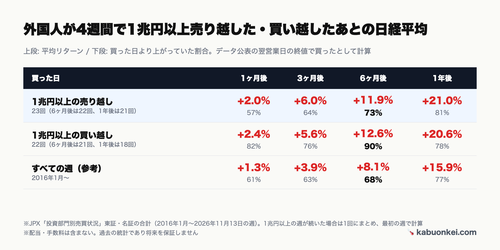
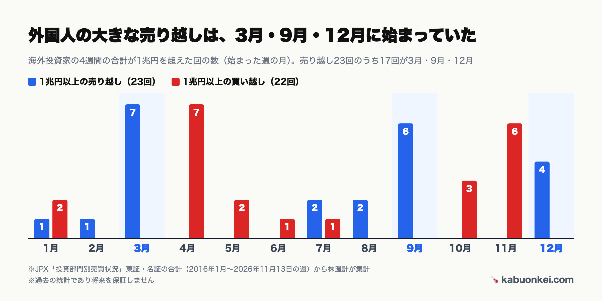

# 「外国人が1兆円売り越した」あと、日経平均はどうなったか——2016年からの566週を全部調べた

<!--
タイトルメモ: ロードマップの 005（信用倍率 × 市場温度）を後ろに回し、サイトの /learn/what-is-investor-flow に
2026-11-20 に足した検証（PR #161）を note に転用する回。11 月に入って海外投資家が売り越しに転じた今の状況をフックに使う。
代替タイトル案:
- 海外投資家の「売り越し」ニュースは、先を読む材料になるのか——10年分の週次データで確かめた
- 外国人が大きく売った23回、その後の日経平均を1回ずつ追った
-->

<!--
note投稿用原稿（第5弾）
- データ基準日: 2026-11-19（日経225 の終値は 2026-11-19 まで。投資部門別は 2026-11-09〜13 の週（11/19 公表）まで）
- データ:
  - 投資部門別: src/data/investor-flow-history.json（JPX「投資部門別売買状況」週間、二市場＝東証・名証の合計、
    2016-01-04 の週〜2026-11-13 の週の 566 週。npm run update:investor-flow -- --full で作成）
  - 日経225: Yahoo Finance の ^N225
- 集計ロジック（サイトの learn-extra-stats.json の investorFlow と同じ。scripts/_lib/learn-extra-stats.ts）:
  - 「公表後」: 翌週の第 4 営業日（原則木曜）の 15:30 に公表されるので、その次の営業日の終値で買ったことにする
  - その後のリターン: 21 / 63 / 126 / 252 営業日後（1ヶ月 / 3ヶ月 / 6ヶ月 / 1年）。配当は含まない
  - 向きの一致: 海外投資家のその週の差引の符号 × 日経225 の騰落の符号（同じ週 = 前の週の最後の終値 → その週の最後の終値、
    公表後 1 週間 = 公表翌営業日の終値 → その 5 営業日後）
  - 4 週累計: 直近 4 週の差引の合計（サイトの「需給の温度」と同じ）。±1 兆円は需給の温度の 25 / 75 に当たる区切りで、結果を見る前に決めた
  - 「1回」のまとめ方: 4 週累計が 1 兆円以上の売り越し（買い越し）の週が続いた場合は 1 回にまとめ、最初の週の公表翌営業日に買ったことにする。
    サイトの表は週数で数えている（売り越し 62 週・買い越し 82 週）が、この記事は回数（23 回・22 回）で数える（004 と同じ考え方）
  - 個人の向き: 1 回目の週の時点の個人の 4 週累計の符号。「同じ 4 週間の日経225」は 4 週累計の最初の週の前の終値 → その週の最後の終値（4 週累計と同じ期間）
  - 回数ベースの数字は一時スクリプトで計算（リポジトリには残していない）。2026-11-20 に計算
- 出来事の呼び名（コロナ・ショック、令和のブラックマンデー、トランプ関税ショック、AI規制ショック）は日付と照らして付けたもの。**投稿前に人間確認**
- 投稿時の作業: 図版添付（images/ 参照）、markdown 表を削除して表画像に置換。
  PR #161（サイト側の検証）がマージ・本番反映されてから公開する（本文から /learn/what-is-investor-flow#data にリンクしているため）。
  投稿日がずれて新しい週の投資部門別が出た場合は「いまはどこにいるか」の数字を更新する
- リンクはすべて文字リンク（URL をそのまま貼らない）
- X bot は 2026-11-20 に定時投稿を再開。フッターの X 導線は**アカウント URL を入れて戻す**（TODO）
- 図版（スタイル付き HTML を headless browser で 2x 撮影。HTML ソースは images/src/）:
  - アイキャッチ: images/note005-eyecatch.png（タイトル + 向きの一致「同じ週 68% / 公表後 1 週間 51%」）
  - images/note005-returns-table.png（検証2: 1 兆円以上の売り越し / 買い越し / すべての週）
  - images/note005-month-chart.png（検証3: 1 兆円を超えた回が始まった月）
-->

## この秋、海外投資家が「買い」から「売り」に転じた

毎週木曜日の午後になると、「海外投資家が○週連続で売り越し」「外国人の買い越し額が今年最大」といったニュースが流れます。日本取引所グループ（JPX）が、前の週に誰がどれだけ日本株を売り買いしたかを公表する日だからです。

この秋の数字は、かなり大きく動きました。

- 10月5日〜9日の週、海外投資家は1週間で**1兆4,318億円**の買い越し
- 10月9日の週までの4週間の合計は、**1兆6,522億円**の買い越し
- それが10月半ばから売り越しの週が増え、11月6日の週には4週間の合計もマイナスに。11月13日の週までの4週間の合計は**5,771億円の売り越し**

その間の11月6日には、日経平均が1日で-5.96%下げています（第3弾で取り上げた「AI規制ショック」）。

「外国人が売っているなら、まだ下がるのでは」と感じる人も多いと思います。私が作っている「株温計」でも、海外投資家の4週間の売り買いを「需給の温度」として毎日表示しています。ただ、その数字が**先を読む材料になるのか**は、きちんと確かめたことがありませんでした。

そこで今回、JPXが公表している週次データを2016年1月までさかのぼって集め、566週ぶんを全部調べました。

先に結論を書きます。

- 海外投資家が買い越した週は日経平均も上がり、売り越した週は下がる。この一致は**68%**。ところが、データが**公表された後の1週間**で見ると**51%**で、ほぼ五分五分だった
- 4週間で**1兆円以上売り越した**のは**23回**。その後6ヶ月で日経平均が上がっていたのは**22回中16回（73%）**で、普段の週（68%）と比べて悪くなかった
- ただし、**1兆円以上買い越した**後のほうが成績は良く、6ヶ月後に上がっていたのは**21回中19回（90%）**
- 1兆円以上の売り越しの23回のうち**17回は3月・9月・12月**に始まっていた。買い越しの22回では、この3つの月は**0回**
- 海外投資家が大きく売ったとき、個人は、株価が下がっていた回では**13回中11回**買い越していた。株価が上がっていた回では**10回中2回**だけ

順番に見ていきます。

## 投資部門別売買状況とは

JPXが毎週公表している統計で、海外投資家・個人・投資信託・信託銀行など、**誰が日本株をどれだけ買い、どれだけ売ったか**が分かります。日本株の売買の6割ほどは海外投資家なので、ニュースでは海外投資家の数字がよく取り上げられます。

詳しくはサイトの解説記事[「投資部門別売買動向とは？外国人投資家のフローを毎週どう読むか」](https://www.kabuonkei.com/learn/what-is-investor-flow?utm_source=note&utm_medium=article&utm_campaign=note-005)にまとめています。

## 調べ方

- **データ**: JPXの「投資部門別売買状況」（週間）。2016年1月4日の週から2026年11月13日の週までの**566週**
- **市場**: 東証と名証の合計。2022年4月に東証一部がプライム市場に変わったため、10年を同じ基準で比べられるように合計を使いました。東証プライムだけの数字とは、週によって数千億円ずれることがあります
- **公表後に買ったとき**: 週次データは翌週の第4営業日（ふつうは木曜日）の15時30分に公表されます。取引が終わる時刻と同じなので、**その次の営業日の終値**で日経平均を買ったことにしました。「ニュースを見てから動いた場合」の成績です
- **その後のリターン**: 買った日から21営業日後・63営業日後・126営業日後・252営業日後の終値まで（以下、1ヶ月後・3ヶ月後・6ヶ月後・1年後）。配当は含みません

## 検証1: 外国人の売り買いと、日経平均の向きは一致するか

海外投資家がその週に買い越したか売り越したかと、日経平均がその週に上がったか下がったかを比べました。

- **同じ週**: 向きが一致したのは**566週中68%**
- **公表後の1週間**: 向きが一致したのは**564週中51%**

同じ週で見ると、約7割の週で向きがそろっています。海外投資家が「日本株の主役」と言われるのは、数字の上でもそのとおりです。

ところが、データが公表されてから1週間の値動きで見ると、一致は51%。コインを投げるのとほとんど変わりません。**ニュースで「外国人が売り越し」と知った時点では、もう株価は動いた後**、ということです。

4週間の合計で見ても同じです。海外投資家の4週間の合計の向きと、**同じ4週間**の日経平均の向きは**66%**で一致していました。外国人が売り越していた4週間は、日経平均も下がっていたことが多い。ただ、外国人の売りが株価を下げたのか、株価が下がったから外国人が売ったのかは、このデータだけでは区別できません。

## 検証2: 4週間で1兆円以上売り越した後、日経平均はどうなったか

1週間の数字だけでは、たまたま大きく動いた週に引っぱられます。株温計の「需給の温度」と同じく、**直近4週間の合計**で見ました。区切りは、需給の温度の25と75に当たる**±1兆円**です（結果を見る前に決めた区切りです）。

1兆円以上の売り越しが何週も続いた場合は、**1回**にまとめて、その最初の週の公表後に買ったことにしました。前回のVIXの記事で書いたとおり、続いた週をすべて数えると、長引いた局面ほど何度も数えられてしまうからです。

<!-- ↓ この markdown 表は GitHub レビュー用。note は表非対応のため、投稿時は上の画像だけを使い、この表は削除する -->

| 買った日 | 1ヶ月後 | 3ヶ月後 | 6ヶ月後 | 1年後 |
|---|---|---|---|---|
| 1兆円以上の売り越し（23回） | +2.0%（57%） | +6.0%（64%） | +11.9%（73%） | +21.0%（81%） |
| 1兆円以上の買い越し（22回） | +2.4%（82%） | +5.6%（76%） | +12.6%（90%） | +20.6%（78%） |
| すべての週（参考） | +1.3%（61%） | +3.9%（63%） | +8.1%（68%） | +15.9%（77%） |

（かっこ内は、買った日より上がっていた割合。まだ期間が来ていない回は除くため、6ヶ月後は売り越し22回・買い越し21回、1年後は21回・18回）

1兆円以上売り越した後でも、6ヶ月後に日経平均が上がっていたのは22回中16回（73%）、平均は+11.9%でした。すべての週（68%、+8.1%）と比べて、悪くはありません。**「外国人が大きく売ったから、自分も売る」は、この10年のデータでは得になっていませんでした**。

ただ、正直に書いておくと、**1兆円以上買い越した後のほうが勝率は高い**です。1ヶ月後で82%、6ヶ月後で90%。売り越しの後（57%、73%）より上です。平均リターンはどちらも同じくらいなので、「売り越しの後は、上がるときは大きいが、下がる回も多い」という形です。

売り越しの後にさらに下げた回もあります。公表後に買ってから6ヶ月以内に-10%より深く下げたのは、23回中**6回**でした。

- 2024年12月20日の週の後（公表後に買った日から最大-22.7%）、2025年3月14日の週の後（最大-17.2%）: どちらもその後の2025年4月のトランプ関税ショックで下げた
- 2026年8月21日の週の後（最大-13.5%）: いったん10月に7万円台まで上がったあと、11月6日のAI規制ショックで買った日の水準を割り込んだ（11月19日まで。まだ6ヶ月たっていない）
- ほかに、2021年12月、2016年1月、2018年12月の後

反対に、一番よかったのは2020年3月13日の週の後（コロナ・ショックの最中）で、6ヶ月後は+39.2%でした。2024年8月2日の週（令和のブラックマンデーの直前の週）の後も、6ヶ月後は+12.1%です。

## 検証3: 大きな売り越しは3月・9月・12月に集中していた

23回を並べていて、気づいたことがあります。始まった月が偏っているのです。

<!-- ↓ GitHub レビュー用。投稿時は上の画像だけを使う -->

- 1兆円以上の売り越し（23回）: 3月 7回、9月 6回、12月 4回、7月・8月 各2回、1月・2月 各1回
- 1兆円以上の買い越し（22回）: 4月 7回、11月 6回、10月 3回、1月・5月 各2回、6月・7月 各1回

売り越しの23回のうち**17回が3月・9月・12月**です。12ヶ月のうち3ヶ月なので、偶然なら4分の1（6回ほど）のはずです。一方、買い越しの22回のうち、この3つの月に始まったのは**0回**でした。買い越しは4月と11月に多くなっています。

3月と9月は、日本の多くの企業の決算期末・中間期末で、配当の権利が確定する月でもあります。ただ、**なぜこの月に海外投資家が大きく売るのか、このデータだけでは分かりません**。言えるのは、「3月・9月・12月に外国人の大きな売り越しが出るのは、この10年では珍しくなかった」ということです。この時期に「外国人が1兆円売り越し」というニュースを見ても、それだけで特別な事態とは限りません。

## 検証4: そのとき、個人はどうしていたか

よく言われるのが「外国人が売ると、個人が買い向かう」という話です。566週で見ると、海外投資家と個人の売り買いが逆向きだった週は**69%**ありました。

1兆円以上の売り越しの23回について、その時点の個人の4週間の合計を見ると、買い越していたのは23回中13回です。半分を少し超える程度ですが、**株価の動きで分けると、はっきり分かれます**。

- 同じ4週間に日経平均が**下がっていた**13回: 個人が買い越していたのは**11回**
- 同じ4週間に日経平均が**上がっていた**10回: 個人が買い越していたのは**2回**

個人は「外国人の逆」に動いているというより、**株価が下がったところで買っている**ように見えます。外国人が売り、株価も下がっていた回に、個人が買い向かう。2016年1月、2018年2月、2020年3月、2022年3月、2024年8月、2026年3月などがそうでした。

その13回の6ヶ月後を見ると、上がっていたのは9回です。株価が上がっていた回（6ヶ月たった9回中7回）と比べて、特に良くも悪くもありませんでした。

## いまはどこにいるか

最後に、今の状況です（11月13日の週まで）。

- 海外投資家の4週間の合計: **5,771億円の売り越し**（1兆円には届いていない）
- 個人の4週間の合計: 4週続けて売り越しで、11月13日の週までの4週間で**9,466億円の売り越し**
- 株温計の日本市場の温度: 11月19日で**18°**（極寒、20°以下）

<!-- 個人の 4 週累計: 11/13 週までの 4 週（10/23・10/30・11/6・11/13）の個人の差引 -716.3 / -332.4 / -4,802.6 / -3,614.7 の合計 -9,466 億円 -->

今回は、外国人と個人が**そろって売り越している**のが目立ちます。566週のうち7割近くは逆向きだったので、そろって売るのは少数派の週です。ここまで見てきたように、これが先を読む材料になるかは分かりません。ただ、「外国人の売りを個人が受け止めている」状態ではない、ということは言えます。

## で、どう使えばいいのか

検証結果をまとめます。

1. 外国人の売り買いと日経平均の向きは、同じ週なら68%一致する。でも公表後の1週間は51%で、ニュースを見てから動いても間に合わない
2. 4週間で1兆円以上売り越した23回の後も、6ヶ月後に上がっていたのは73%。普段の週（68%）より悪くなかった。ただし買い越しの後（90%）のほうが良かった
3. 大きな売り越しの4分の3は3月・9月・12月に始まっていた。この時期の「外国人が大きく売り越し」は珍しくない
4. 個人は、外国人の逆というより、株価が下がったところで買っていた

私はこの結果を、**「外国人の売り買いは、いま誰が動いているかを知るデータであって、次にどうなるかを教えてくれるデータではない」**と受け取っています。サイトの解説記事にも「結果論として面白い」と書いていましたが、それを数字で確かめた形です。

株温計の日本市場の温度は、2026年11月から、日経平均と移動平均の乖離だけで決めるように変えました。外国人の売り買いは温度に混ぜず、「需給の温度」として別に並べています。今回の結果を見ても、その分け方で良かったと思っています。

念のため、いつもの免責も。**これは過去の統計であって、未来を保証するものではありません**。2016年からの10年は日経平均が大きく上がった期間で、すべての週で見ても6ヶ月後に上がっていた割合が68%と高めです。1兆円以上の売り越しは23回しかなく、1回の当たり外れで割合が数%ずつ動きます。

検証の表は、サイトの解説記事の[「株温計のデータで確かめると」](https://www.kabuonkei.com/learn/what-is-investor-flow?utm_source=note&utm_medium=article&utm_campaign=note-005#data)の節にもまとめています（サイトの表は回数ではなく週数で数えています）。

「続けて起きたものを1回にまとめると、勝率が変わる」という話は、前回の[VIXが30を超えた日の記事](https://note.com/ao_bubbles/n/n6a349bd06950)で詳しく書きました。日経平均が1日で5%以上下げた後の話は、第3弾の[急落26回を全部追った記事](https://note.com/ao_bubbles/n/n2cdead0198d1)にあります。

---

## 株温計はこちら

- 🌡️ [株温計](https://www.kabuonkei.com/?utm_source=note&utm_medium=article&utm_campaign=note-005) — 日本市場と米国市場の「今日の温度」を毎日更新しています
- 🌐 [投資部門別売買動向の解説](https://www.kabuonkei.com/learn/what-is-investor-flow?utm_source=note&utm_medium=article&utm_campaign=note-005) — 外国人・個人など主体別の売り買いの読み方と、今回の検証の表
- 📧 [温度アラート](https://www.kabuonkei.com/alerts?utm_source=note&utm_medium=article&utm_campaign=note-005) — 温度が極端（20°以下 / 80°以上）になったときだけメールでお知らせ（無料）
<!-- TODO: X bot 再開済み（2026-11-20）。アカウント URL を入れて戻す
- 🐦 [X（毎朝の温度投稿）](https://x.com/XXXX) — 毎朝7時に日本と米国の温度をお知らせ
-->

※本記事は情報提供を目的としたものであり、特定の金融商品の売買を推奨するものではありません。投資判断はご自身の責任でお願いします。
